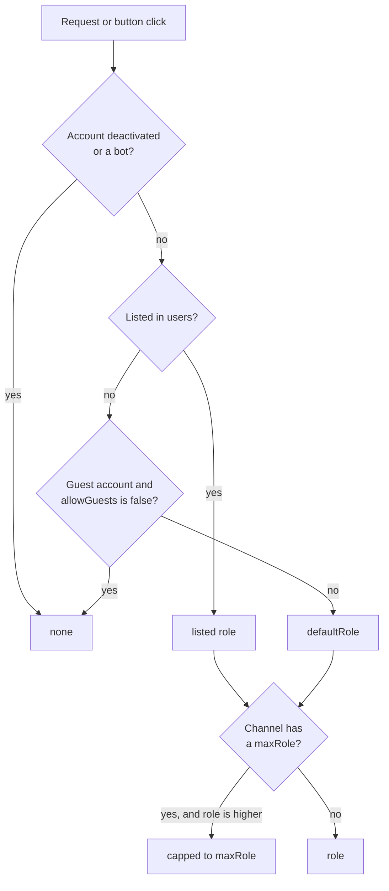

# Access control (RBAC)

Who may use the bot, and what each person may do, is set in one file: `access.json` (path in `ACCESS_FILE`). The file format is in the [access.json reference](/reference/access-json).

## Roles

Four roles, from least to most:

| | `none` | `viewer` | `member` | `admin` |
|---|---|---|---|---|
| Use the bot | — | ✓ | ✓ | ✓ |
| Tools | — | `read,grep,find,ls` | `PI_TOOLS` | `PI_TOOLS_TRUSTED` |
| Share files with the bot (`readUploads`) | — | — | ✓ | ✓ |
| Receive generated files (`createFiles`) | — | — | ✓ | ✓ |
| Deep research (`deepResearch`) | — | — | — | ✓ |
| Cancel other people's requests (`cancelAny`) | — | — | — | ✓ |
| Requests at once (`maxJobs`) | — | 1 | `MAX_JOBS_PER_USER` | `MAX_JOBS_PER_USER` |

Every column can be changed per role in `access.json`. Tools only work if the matching pi package is installed.

## How a person's role is decided



The answer is checked:

- **When a request arrives:** people with `none` who mention the bot get a private note with their member ID. With `THREAD_FOLLOW=true`, their untagged messages in a followed thread are ignored silently.
- **Again just before the agent runs:** a request queued before someone's access was removed is stopped.
- **On every button click:** Cancel, Start research, Edit plan, Discard, Resume.

`access.json` is re-read whenever it changes on disk. **No restart.** A broken edit is logged (`access_file_error`), and the last good version stays in use. If the bot has never read a good version, it denies everyone.

## Finding member IDs

**From the server:**

```bash
cd /opt/pi-slack-bridge && sudo -u pi-bot node list-users.js
```

It prints a table of every account: member ID, display name, full name, account type (member, admin, owner, guest, bot, deactivated), and the role it currently gets.

**Starter file:** this command writes a starter `access.json` with every active, non-guest person:

```bash
sudo -u pi-bot sh -c 'node list-users.js --init > access.json'
```

| Option | Effect |
|---|---|
| `--role viewer` | Everyone starts as viewer instead of member |
| `--include-guests` | Include guest accounts |

**In Slack:** open someone's profile → **⋮ More** → **Copy member ID**. Anyone can see their own ID with `@assistant whoami`.

## Recipes

**A small, trusting team.** Everyone is a member; two admins:

```json
{
  "defaultRole": "member",
  "users": {
    "U01AAAAAAAA": { "role": "admin", "name": "Ada" },
    "U02BBBBBBBB": { "role": "admin", "name": "Ben" }
  }
}
```

With `defaultRole: "member"`, new hires get access automatically. Guests still don't, unless `allowGuests` is `true`.

**Least privilege.** Only listed people, most as viewers:

```json
{
  "defaultRole": "none",
  "roles": { "viewer": { "tools": "read,grep,find,ls,web_search_exa" } },
  "users": {
    "U01AAAAAAAA": "admin",
    "U02BBBBBBBB": "member",
    "U03CCCCCCCC": "viewer"
  }
}
```

**Tone it down in a busy channel.** In #general, admins act as members:

```json
{ "channels": { "C04DDDDDDDD": { "maxRole": "member", "name": "#general" } } }
```

**Let members run deep research:**

```json
{ "roles": { "member": { "deepResearch": true } } }
```

**A contractor (guest) gets read-only access:**

```json
{ "users": { "U05EEEEEEEE": { "role": "viewer", "name": "Contractor" } } }
```

Listing a guest by ID gives them that role even with `allowGuests: false`.

## Zero-trust principles, mapped

| Principle | How the bot applies it |
|---|---|
| **Continuous verification** | Role checked on arrival, before running, and on every click. Deactivated accounts lose access within the 10-minute user cache. File edits apply on the next request. |
| **Micro-segmentation** | Per-channel `maxRole` caps. One workspace folder for file tools. Uploads readable only for the request they came with. Research folders per thread. |
| **Least privilege** | Default role `none`. Tools passed as an allowlist on every run. Shell, edit and write only for roles that list them. Deep research only from an approved plan. |
| **Assume breach** | Secrets scrubbed from every reply, internal paths hidden, Slack tokens never given to the agent, package installs blocked. Logs record every decision. |

## Without an access file

If `ACCESS_FILE` is not set, the bot runs in legacy mode and logs `access_warning` at start: everyone is a `member`, and IDs in `TRUSTED_USER_IDS` are `admin`. Use this only for a first test.
