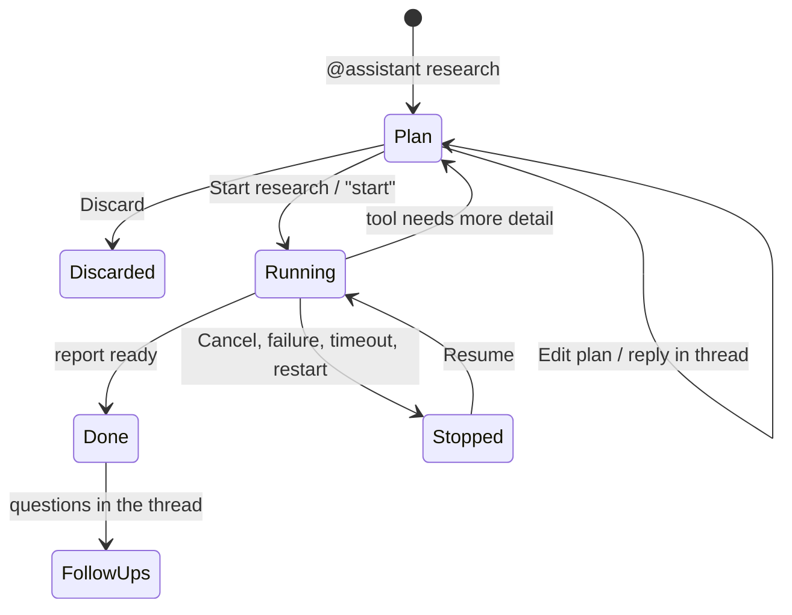

# Deep research

Deep research produces a cited, fact-checked report on a question. It searches many pages, reads them, and checks claims against the pages it fetched. It runs for several minutes, so the bot wraps it in a workflow made for Slack: a plan you approve, live progress, and the report as files.

Available to roles with `deepResearch: true` (admin by default). Setup: [Deep research setup](/setup/deep-research).

## The workflow



### 1. Ask

```
@assistant research open-source vector databases for RAG in 2026
```

`deep research …` works too. In a thread, `@assistant research` with no topic researches what the thread discusses.

### 2. Review the plan

Within seconds the bot posts a **plan card**:

- **Research question:** rewritten to stand on its own, with the limits you or the conversation gave (dates, region, versions, budget).
- **What I'll look into:** 3 to 6 angles.
- **A few questions first** *(optional)*: up to three questions that would change the research, with example answers.
- **Depth:** Quick, Standard or Deep. **Sources:** the whole web, or only the sites you named.
- **Buttons:** ▶ **Start research**, ✏️ **Edit plan**, **Discard**.

Change it any way you like:

- **Edit plan** opens a form: the question, angles, your answers, depth and allowed websites.
- **Reply in the thread** with a mention, for example `@assistant only EU providers, and skip pricing`. The bot posts an updated card and marks the old one as replaced.
- **`@assistant start`** in the thread works like the Start button.

pi's own plan dialog only works in its terminal interface, which the bot doesn't use. The card replaces it.

### 3. Watch it run

A status message updates every 15 seconds with the current phase, the tool's latest progress lines, counters such as sources found, and the elapsed time. It has a **Cancel** button.

- **One run per thread.** While research runs in a thread, other requests there are turned away, so they don't wait behind it.
- **Shared slots.** At most `RESEARCH_MAX_CONCURRENT` runs (default 1) at once across the bot. More wait in the queue.

### 4. Get the report

- **Summary:** a direct answer, key findings with linked sources, the report's confidence, and any unconfirmed claims, clearly marked.
- **Files:** the full report as **PDF** and **Markdown**.
- **Footer:** the run time, confidence, and how many sources were cited.

### 5. Ask follow-ups

Mention the bot in the same thread. For admins, follow-ups use the `research_ask` tool: it answers from the pages the research already read, without searching again. Those answers are not fact-checked, and the bot says so.

## When it doesn't finish

| What happened | What you see |
|---|---|
| You pressed Cancel | *Research cancelled by …* with **↻ Resume research** |
| The search provider rate-limited | The reason, advice to wait about ten minutes, and Resume |
| It timed out (`RESEARCH_TIMEOUT_MS`) | The reason, and Resume |
| The bot restarted | *The bot restarted before the research finished* and Resume |
| drsh failed before searching | The reason from drsh, for example *while checking the search backend: …* |

Resume continues from the saved checkpoint without repeating finished searches. Cancel first asks the run to stop cleanly so it can save, and forces it after 15 seconds.

If the tool asks clarifying questions itself, they come back as a new plan card. Nothing has been searched at that point.

## Where things are kept

Each thread has a folder under `RESEARCH_DIR` with its runs: report, sources and checkpoints. The bot uses it to find the report for follow-ups and the checkpoint for Resume. Folders unused for `RESEARCH_KEEP_DAYS` (30) are deleted. Paths are hidden from everything posted to Slack.

## Access rules

- **Who can act:** Start, Edit plan, Discard and Resume check the role of the person clicking, at the moment they click.
- **Plans:** live in memory for 24 hours. After a restart, old plan buttons say the plan is no longer available.
- **Tools:** the `deep_research` tool is never available in a normal request, only in a run started from an approved plan. People without deep research who write `research …` get a normal answer and a private note.
