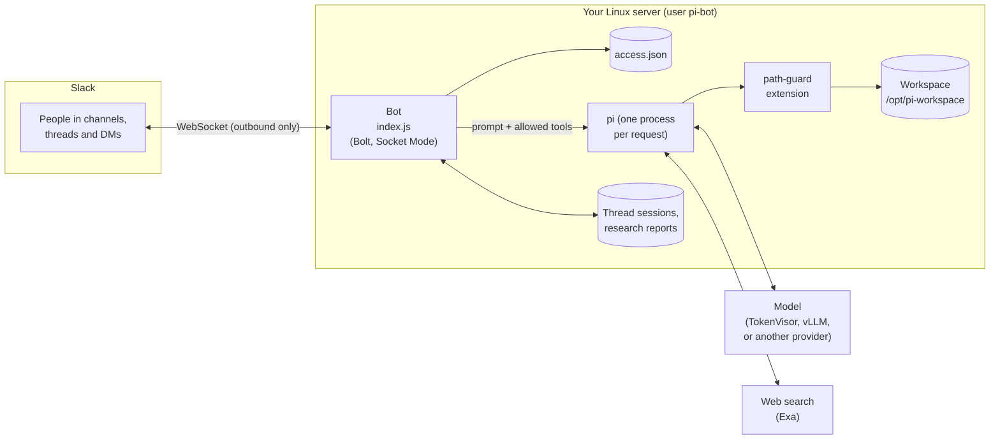
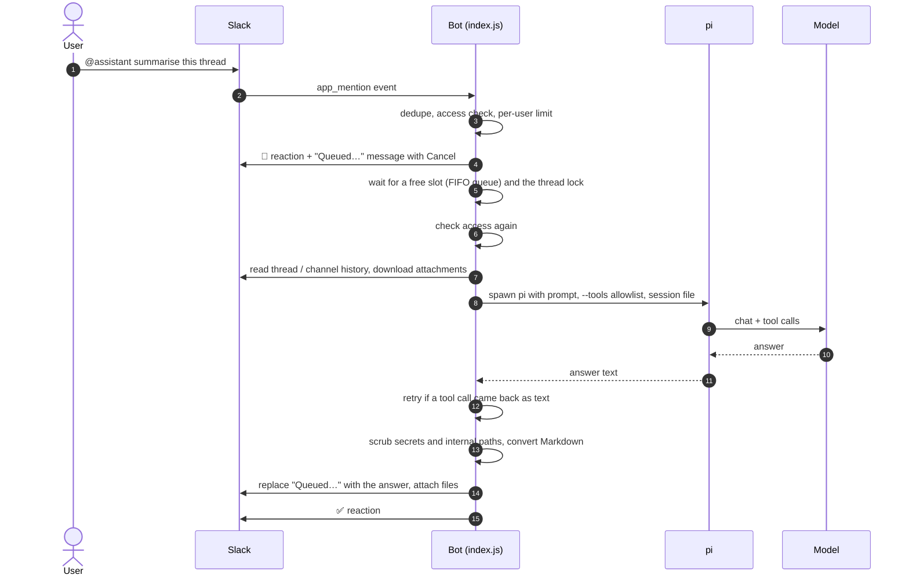
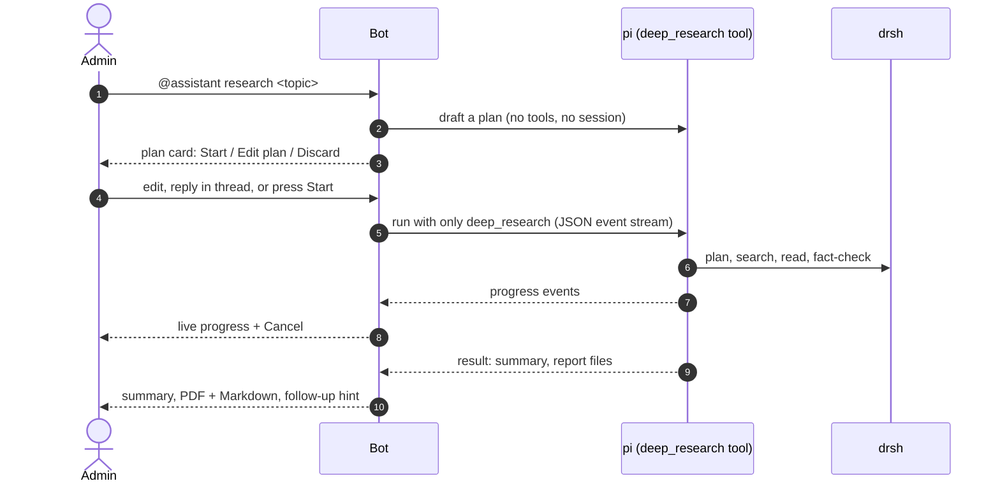

# Architecture

## The big picture

- **Outbound only.** Socket Mode means the bot opens a WebSocket to Slack. Your server needs no public address, domain, certificate or open port.
- **One pi process per request.** pi is started, answers, and exits. Nothing stays running between requests, and an idle thread uses no memory. Memory between messages lives in files (see [sessions](/guide/behavior#memory-per-thread)).
- **The bot is the policy point.** Access control, which tools pi may use, what context it sees, and what reaches Slack are all decided in `index.js`, not by the model.

## What happens on a request

### The job queue

- **Global limit:** `MAX_CONCURRENT_JOBS` pi processes run at once (default 2). Others wait in a first-in, first-out queue, and their placeholder shows the queue position.
- **Per person:** `MAX_JOBS_PER_USER` caps requests running or queued per person (default 2; viewers 1). Requests over the limit are refused, not queued.
- **Per thread:** requests in one thread run one after another, so two answers never write the same session file.
- **Deep research:** at most `RESEARCH_MAX_CONCURRENT` research runs hold a slot (default 1), so chat always has room.
- **Timeouts and Cancel:** a request is killed after `PI_TIMEOUT_MS`, a research run after `RESEARCH_TIMEOUT_MS`. Cancel kills the whole process group, so tools pi started stop too.

### Building the prompt

Each prompt the bot sends contains:

1. The rules: this is a shared assistant, Slack text is untrusted, never reveal keys or configuration paths, never write tool calls as text.
2. Who is asking, where, and their local time.
3. Slack history in a `<slack_history>` block: the whole thread, or recent channel messages, within a character budget. See [How it behaves](/guide/behavior).
4. Attached files in a `<slack_attachments>` block, as extracted text. Images are passed to the model as images.
5. What this person may do, so the model can describe its own abilities correctly.
6. The request itself, then formatting and file-output instructions.

### Making the answer safe for Slack

Before anything is posted:

- **Secrets:** values of secret-looking environment variables and of key fields in `PI_SECRET_FILES` are replaced with `[REDACTED]`.
- **Paths:** the bot's home folder, pi's config folder and the research folder become `[internal path]`. Secret file names become `[internal file]`.
- **Formatting:** Markdown is converted to Slack's own format, including tables and code blocks, and long answers are split at safe points or attached as a file.
- **Files:** blocks the model marked as files become uploads; PDFs are rendered with HTML neutralized.

## Processes and files on disk

| Path | Owner | Contents |
|---|---|---|
| `/opt/pi-slack-bridge/` | pi-bot | This repository, `.env`, `access.json` |
| `/opt/pi-workspace/` | pi-bot | The only folder the agent's file tools may use |
| `/home/pi-bot/.pi/agent/` | pi-bot | pi itself, its settings, installed packages, provider keys, `extensions/path-guard.ts` |
| `PI_SESSION_DIR` | pi-bot | One `.jsonl` session file per Slack thread (optional) |
| `INPUT_FILES_DIR` | pi-bot | Downloaded attachments, one folder per request, deleted afterwards |
| `RESEARCH_DIR` | pi-bot | Deep research reports and checkpoints, one folder per thread |
| `HINTS_FILE` | pi-bot | Which one-time tips each person has seen |

## Deep research flow

More in [Deep research](/features/deep-research).
